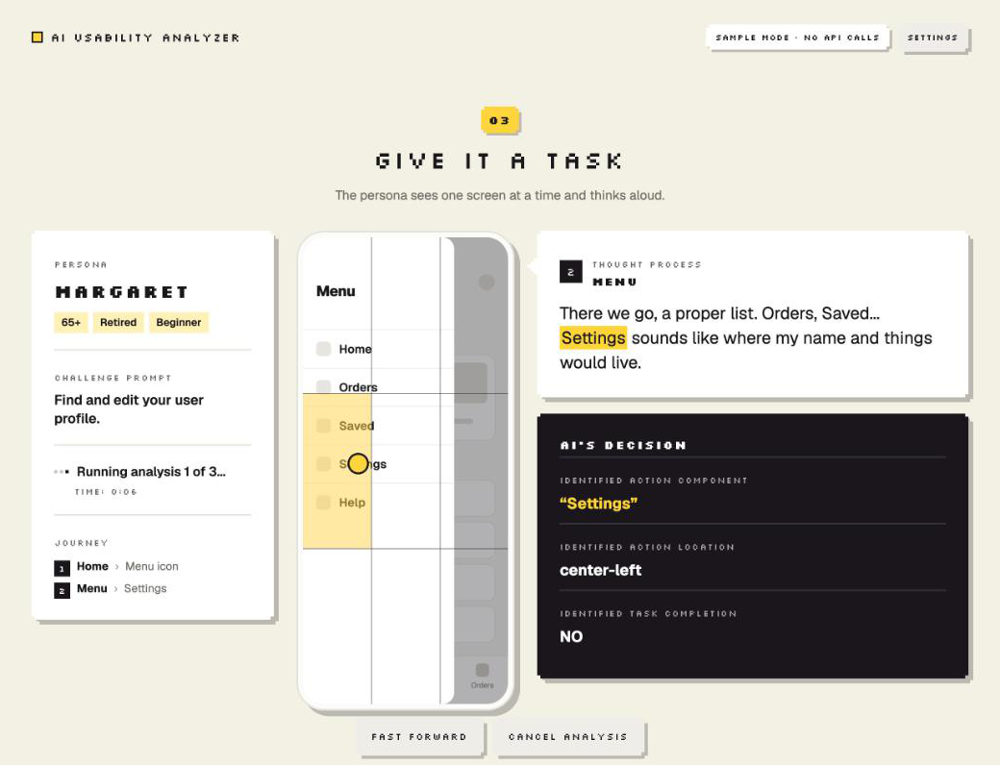

# AI Usability Analyzer

Simulated usability testing for Figma prototypes.

Give it a Figma prototype, a persona and a task. An AI persona is shown the
first screen, thinks aloud, and names what it would tap. The tool finds that
element in the prototype, follows its connection to the next screen, and
repeats until the persona sees the task is done or runs out of patience.
Every run ends in a report: whether the task was completed, how many steps
it took, a System Usability Scale (SUS) score answered as the persona, and
any element the persona reached for that the prototype has not wired up.

It is a fast first pass over a flow before you put it in front of people,
not a replacement for testing with them.



## Try it without any keys

```bash
git clone https://github.com/ktsao1/AI-UX-Analyzer.git
cd AI-UX-Analyzer
npm install
npm run dev
```

Open the address Vite prints (usually http://localhost:5173) and choose
**Try the sample prototype**. Sample mode makes no network calls: it walks a
bundled six-screen wireframe app using a pre-written session, so you can see
every part of the tool working. The persona's words in sample mode are
written by hand; the journey, the design gap and the scores are worked out
from them by the same code a live run uses.

Requires Node.js 20 or newer.

## Test your own prototype

You need two keys:

| Key | Where to get it |
| --- | --- |
| Gemini API key | [aistudio.google.com/apikey](https://aistudio.google.com/apikey) |
| Figma personal access token | Figma → Settings → Security → Personal access tokens, with read access to file content |

Add them in the app's **Settings** panel (they are stored in your browser's
localStorage and sent only to Figma and Google), or put them in a file:

```bash
cp .env.example .env.local
# then fill in VITE_GEMINI_API_KEY and VITE_FIGMA_TOKEN
```

Then:

1. **Link your prototype.** In Figma, select any frame in the file and copy
   its link (it must contain `node-id=`). Paste it and press *Fetch File
   Data*. The tool reads the file's screens and prototype connections and
   lists its flows. Pick the flow to test.
2. **Cast your tester.** Choose a ready-made persona (Boomer, Millennial,
   Gen Z), or set age range, gender, employment, tech savviness and income,
   add any details, and let Gemini write the persona in the first person.
   *Regenerate* writes another.
3. **Give it a task.** Write the challenge in plain words ("Find and edit
   your user profile") and choose how many passes to run, from 1 to 10.
4. **Read the results.** One pass gives its completion, time, steps and SUS
   score, the ten SUS answers, the written analysis (emotional reactions,
   accessibility notes, suggestions) and every step with the screen, the
   thought and the decision. Several passes add successes and failures,
   averages, and a row per run to open.

Your Figma file needs prototype connections: screens wired together in
Prototype mode, ideally with a flow starting point. A file with no named
flow gets one flow for each frame that nothing else links to.

Each step is one Gemini request with one screenshot; a completed pass adds
one more for the analysis. Ten passes of a long flow can reach free-tier
rate limits, in which case the tool waits and retries, then reports the
error.

## How it works

```
Figma file ──► screens + hotspots + flows          src/lib/prototype.ts
                    │
persona + task ──► prompt with the journey so far  src/lib/prompts.ts
                    │
              Gemini reply (thought + 4 fields)    src/services/gemini.ts
                    │
              parse ──► match to a hotspot         src/lib/parsing.ts, matching.ts
                    │
              follow the link, or record why not   src/lib/runner.ts
                    │
              report: SUS, gaps, averages          src/lib/sus.ts, summary.ts
```

- **The prototype is a graph.** Each top-level frame is a screen. Any layer
  in it with a tap interaction that navigates to another frame, or goes
  back, is a hotspot, described by its layer name and the text inside it.
- **The model answers in a fixed shape.** After thinking aloud it ends with
  `ACTION_COMPONENT`, `ACTION_LOCATION` (a cell of a 3×3 grid),
  `GO_BACK` and `TASK_COMPLETE`.
- **Matching is by words, then by place.** The named component is compared
  with each hotspot's words; the grid cell breaks ties. An icon with no
  text can be matched on position alone. If nothing fits, the persona
  reached for something that is not wired: that is recorded as a **design
  gap** ("expected but missing UI element"), the persona is told nothing
  happened, and it tries again.
- **Patience ends a run.** A persona's patience (from its tech savviness,
  lowered one level at 65+) sets how many screens it will look at (8, 14 or
  20) and how many dead ends in a row it will accept (2, 3 or 5) before it
  gives up.
- **The task is complete only on proof.** The persona is told to answer
  `TASK_COMPLETE: YES` only when the screenshot already shows the result.
- **SUS is calculated, not asked for.** The model gives ten answers from 1
  to 5 as the persona; the score is worked out with the standard formula
  (odd items score answer − 1, even items 5 − answer, sum × 2.5). A run
  that was not completed is not scored, and the average covers scored runs
  only.

## What it does not do

- It follows tap and click interactions that navigate between frames, and
  "back". Overlays, scrolling, hover, drag, timed transitions, variables
  and conditional logic are ignored, so a flow that depends on them will
  dead-end.
- The persona sees one static screenshot per screen. It cannot type, scroll
  or see animation.
- A language model playing a persona is not a person. Scores vary from run
  to run and are not comparable with SUS scores from real participants. Use
  it to find obvious friction early, then test with users.
- It is a browser-only app, so your keys are in the page. Run it on your own
  machine; do not deploy a build that has real keys in its environment.

## Development

```bash
npm run dev        # start the app
npm test           # unit tests, including the three sample runs end to end
npm run typecheck
npm run build      # typecheck, then a static build in dist/
```

The build in `dist/` is plain static files. Built without keys, it can be
hosted anywhere as a sample-mode demo.

```
src/
  lib/         the logic, with no React or network in it (and the tests' subject)
  services/    Figma, Gemini and the saved settings
  demo/        the sample prototype and its pre-written session
  components/  the interface
tests/
```

Built with React, TypeScript, Vite, Figma's REST API and Google Gemini
(`gemini-2.5-flash` by default; change it in Settings).

## Credits

Built by Kevin Tsao and Andrew Chan.
